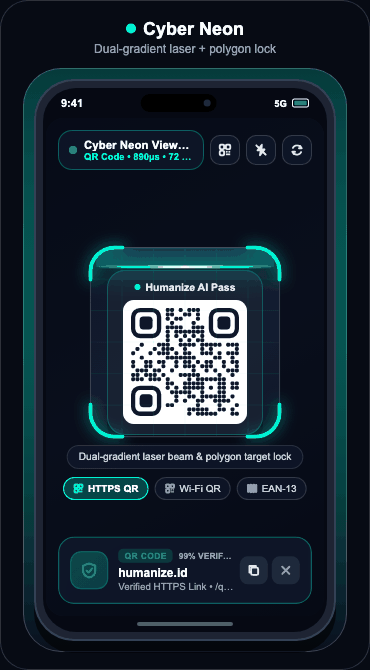
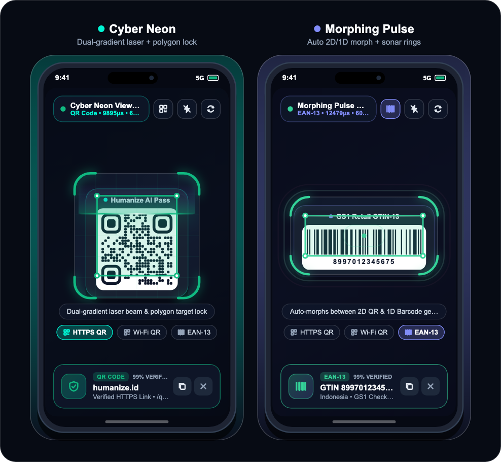
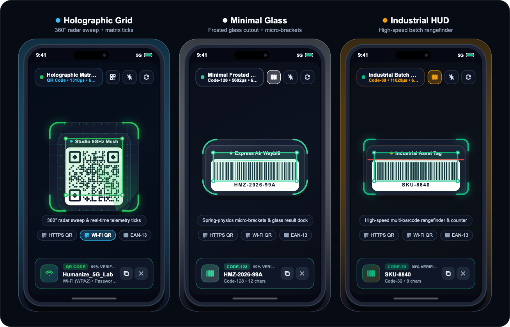

<p align="center">
  
</p>

<h1 align="center">flutter_qr_barcode_scanner</h1>

<p align="center">
  <strong>Modern, lightweight, zero-dependency real-time QR &amp; Barcode Scanner library for Flutter.</strong><br/>
  5 animated viewfinder layouts • Real-time 1D &amp; 2D pixel decoding • Polygon target lock • Semantic payload parser • Flutter 3.50+ ready
</p>

<p align="center">
  <a href="https://pub.dev/packages/flutter_qr_barcode_scanner"></a>
  <a href="https://pub.dev/packages/flutter_qr_barcode_scanner/score"></a>
  <a href="https://github.com/andikpbw/qr_barcode_scanner/blob/main/LICENSE"></a>
  
  
</p>

---

## Live Real-UI Animation Preview

All previews below are captured directly from the live `flutter_qr_barcode_scanner` widget engine running inside mobile device frames:

<p align="center">
  
</p>

### All 5 Signature Viewfinder Layouts in Real Mobile Frames

<p align="center">
  
</p>

<p align="center">
  
</p>

---

## Why `flutter_qr_barcode_scanner`?

- **Zero External Dependencies & Flutter 3.50+ Future-Proof**: Built purely on `package:flutter/widgets.dart` — zero deprecated `package:flutter/material.dart` or `package:flutter/cupertino.dart` imports. Drop it seamlessly into apps using `package:material_ui/material_ui.dart`, `package:cupertino_ui/cupertino_ui.dart`, legacy Material, or custom `WidgetsApp` design systems across **Android, iOS, Web, macOS, Windows, and Linux**.
- **5 Signature Animated Viewfinder Layouts (`QrScannerLayout`)**:
  1. **`QrScannerLayout.cyberNeon`** — Glowing rounded corner brackets with a dual-gradient laser sweep beam, trailing neon aura, and animated 4-corner polygon lock-on reticles.
  2. **`QrScannerLayout.morphingPulse`** — Dynamic-Island-inspired breathing reticle that smoothly morphs between square 2D QR and wide 1D Barcode aspect ratios with concentric sonar pulse rings.
  3. **`QrScannerLayout.holographicGrid`** — Sci-fi perspective holographic matrix grid with a 360° radar sweep cone, ruler telemetry ticks, and live FPS/latency readout.
  4. **`QrScannerLayout.minimalGlass`** — Frosted glassmorphic cutout (`ImageFilter.blur`) with spring-physics micro-brackets, subtle shimmer line, and floating glass result dock.
  5. **`QrScannerLayout.industrialHud`** — High-speed warehouse and retail multi-barcode rangefinder crosshair with dashed alignment guide and batch counter HUD.
- **Real-Time Multi-Format Pixel Decoder (`QrBarcodeDecoder` & `QrBarcodeCodec`)**:
  - Pure-Dart real-time pixel & matrix decoding for **QR Code** (2D matrix with `1:1:3:1:1` finder pattern localization, orientation normalization `0°/90°/180°/270°`, and mask reversal), **EAN-13**, **EAN-8**, **UPC-A**, **UPC-E**, **Code-128**, **Code-39**, **ITF (Interleaved 2 of 5)**, and **Codabar**.
  - Supports **RGBA8888**, **BGRA8888**, **Grayscale8**, and **YUV420** camera frames (`QrScanFrame`) with adaptive local thresholding and inverted (white-on-black) code detection.
- **Semantic Payload Parser (`QrPayloadParser`)**:
  - Automatically classifies and extracts structured fields for **HTTPS URLs**, **Wi-Fi credentials (`WIFI:`)**, **vCard / MECARD contacts**, **GS1 retail products (with modulo-10 checksum & country prefix resolution)**, **UPI / EMVCo / QRIS payments**, **Emails (`mailto:` / `MATMSG:`)**, **SMS**, **Phone numbers**, and **Geographic coordinates (`geo:`)**.
- **Built-in Vector Barcode & QR Renderer (`QrBarcodeGraphic`) & Icons (`QrVectorIcon`)**:
  - Render crisp, resolution-independent 2D QR Codes (with `rounded`, `circle`, `diamond`, or `sharp` finder eyes) and 1D Barcodes plus 18 custom-painted vector scanner glyphs with zero icon-font dependencies.

---

## Installation

```yaml
dependencies:
  flutter_qr_barcode_scanner: ^1.0.0
```

Run:

```bash
flutter pub get
```

---

## Quick Start

```dart
import 'package:flutter/widgets.dart';
import 'package:flutter_qr_barcode_scanner/flutter_qr_barcode_scanner.dart';

class ProductScannerScreen extends StatefulWidget {
  const ProductScannerScreen({super.key});

  @override
  State<ProductScannerScreen> createState() => _ProductScannerScreenState();
}

class _ProductScannerScreenState extends State<ProductScannerScreen> {
  final QrScannerController _controller = QrScannerController();

  @override
  void dispose() {
    _controller.dispose();
    super.dispose();
  }

  @override
  Widget build(BuildContext context) {
    return QrBarcodeScannerView(
      controller: _controller,
      layout: QrScannerLayout.cyberNeon,
      onDetect: (QrScanResult result) {
        debugPrint('Format: ${result.format.displayName}');
        debugPrint('Raw Value: ${result.rawValue}');
        debugPrint('Semantic Title: ${result.payload.displayTitle}');
        debugPrint('Polygon Corners: ${result.corners}');
      },
    );
  }
}
```

---

## Switching Between All 5 Animated Viewfinder Layouts

Switch layouts with a single enum parameter on `QrBarcodeScannerView` — no structural boilerplate required:

```dart
// 1. Glowing corner brackets + dual-gradient neon laser sweep
QrBarcodeScannerView(layout: QrScannerLayout.cyberNeon)

// 2. Dynamic-Island-inspired 2D/1D morphing cutout + sonar pulse rings
QrBarcodeScannerView(layout: QrScannerLayout.morphingPulse)

// 3. 360° radar sweep cone + holographic matrix grid & telemetry ticks
QrBarcodeScannerView(layout: QrScannerLayout.holographicGrid)

// 4. Frosted glassmorphic cutout + spring micro-brackets
QrBarcodeScannerView(layout: QrScannerLayout.minimalGlass)

// 5. High-speed warehouse & logistics rangefinder crosshair HUD
QrBarcodeScannerView(layout: QrScannerLayout.industrialHud)
```

---

## Feeding Live Camera Frames (`QrScannerController` & `QrScanFrame`)

`flutter_qr_barcode_scanner` decouples its real-time decoding engine and animated UI from heavy platform-locked camera plugins, so you can feed frames from any camera source (`camera`, `camerax`, `avfoundation`, WebRTC, or desktop USB webcams) without native dependency conflicts:

```dart
// Decode a 32-bit RGBA, BGRA, YUV420 (Y-plane), or Grayscale camera buffer in real time:
final frame = QrScanFrame.fromYuv420(
  yPlane: cameraImage.planes.first.bytes,
  width: cameraImage.width,
  height: cameraImage.height,
  rowStride: cameraImage.planes.first.bytesPerRow,
);

final List<QrScanResult> detections = controller.processFrame(frame);
```

Or run headless one-shot decoding directly via `QrBarcodeDecoder`:

```dart
final QrScanResult? result = QrBarcodeDecoder.decodeSingle(
  QrScanFrame.fromRgba(
    bytes: rgbaBytes,
    width: imageWidth,
    height: imageHeight,
  ),
  allowedFormats: {
    QrBarcodeFormat.qrCode,
    QrBarcodeFormat.ean13,
    QrBarcodeFormat.code128,
  },
);
```

---

## Programmatic Control (`QrScannerController`)

Control scanning lifecycle, torch illumination, camera lens direction, zoom factor, cutout geometry, and scan history from anywhere:

```dart
final controller = QrScannerController(
  scanCooldown: const Duration(milliseconds: 850),
  enableHaptics: true,
);

// Lifecycle control
controller.start();
controller.pause();
controller.resume();
controller.togglePause();

// Hardware & viewport controls
controller.toggleTorch();
controller.switchCamera();
controller.setZoom(2.0);
controller.toggleCutoutAspectMode(); // Morphs between 2D square and 1D wide cutout

// Observe real-time detections via Stream
controller.resultsStream.listen((QrScanResult result) {
  // Handle verified detection
});
```

---

## Semantic Payload Parser (`QrPayloadParser`)

Every `QrScanResult` includes a pre-parsed `result.payload` (`QrParsedPayload`) with structured key-value metadata:

| `QrPayloadType` | Recognized Formats | Extracted `payload.fields` |
| :--- | :--- | :--- |
| **`url`** | `https://`, `http://`, custom URI schemes | `scheme`, `host`, `path`, `isSecure` |
| **`wifi`** | `WIFI:S:<SSID>;T:<WPA2>;P:<PASS>;;` | `ssid`, `encryption`, `password`, `hidden` |
| **`vCard`** | `BEGIN:VCARD...END:VCARD`, `MECARD:` | `name`, `phone`, `email`, `org`, `url` |
| **`product`** | `EAN-13`, `EAN-8`, `UPC-A`, `UPC-E`, `ITF-14` | `gtin`, `country` (GS1 prefix), `validChecksum` |
| **`payment`** | `upi://pay?...`, EMVCo / QRIS `000201...` | `protocol`, `merchant`, `amount`, `currency` |
| **`email`** | `mailto:`, `MATMSG:TO:...;SUB:...;BODY:...;;` | `email`, `subject`, `body` |
| **`sms`** | `smsto:<number>:<message>`, `sms:` | `phone`, `message` |
| **`phone`** | `tel:+6281234567` | `phone` |
| **`geo`** | `geo:latitude,longitude` | `latitude`, `longitude` |
| **`text`** | Serial numbers, SKUs, custom strings | `length` |

---

## Built-in Vector Barcode & QR Renderer (`QrBarcodeGraphic`)

Render razor-sharp, scannable 2D QR Codes and 1D Barcodes anywhere in your UI using the same pure-Dart `QrBarcodeCodec`:

```dart
// Render a 2D QR Code with custom finder eye shapes
const QrBarcodeGraphic(
  data: 'https://humanize.id',
  format: QrBarcodeFormat.qrCode,
  finderEyeStyle: QrFinderEyeStyle.rounded,
  width: 160,
  height: 160,
)

// Render a 1D EAN-13, UPC-A, Code-128, Code-39, ITF, or Codabar barcode
const QrBarcodeGraphic(
  data: '8997012345675',
  format: QrBarcodeFormat.ean13,
  width: 220,
  height: 84,
)
```

---

## Deep Customization Reference

| Class | Key Properties |
| :--- | :--- |
| **`QrScannerStyle`** | `accentColor`, `secondaryColor`, `successColor`, `frameColor`, `overlayColor`, `cutoutSizeFactor`, `cutoutBorderRadius`, `cornerLength`, `cornerStrokeWidth`, `laserThickness`, `laserGlowBlur`, `frostedBlurSigma`, `showGrid`, `showTelemetry`, `showPolygonOverlay`, `showResultSheet`, `showTopBar`, `showBottomControls`, `title`, `subtitle` |
| **`QrScannerMotionConfig`** | `laserSweepDuration`, `lockOnDuration`, `morphDuration`, `scanCooldown`, `sweepCurve`, `lockCurve`, `morphCurve`, `enableHaptics`, `autoSimulateInPreview` |
| **`QrVectorIcon`** | 18 pure-Flutter vector glyphs (`qrCode`, `barcode`, `flashOn`, `flashOff`, `cameraSwitch`, `gallery`, `zoomIn`, `zoomOut`, `checkCircle`, `copy`, `link`, `wifi`, `sparkle`, `history`, `layers`, `focus`, `close`, `shieldCheck`) |

---

## Support

If this library helps accelerate your Flutter projects, please consider supporting its ongoing development through **[Humanize AI](https://humanize.id)**.

- **Support & Sponsor:** [Humanize AI](https://humanize.id)
- **Repository:** [github.com/andikpbw/qr_barcode_scanner](https://github.com/andikpbw/qr_barcode_scanner)
- **Issues & Feature Requests:** [GitHub Issues](https://github.com/andikpbw/qr_barcode_scanner/issues)

---

## License

Released under the [MIT License](https://github.com/andikpbw/qr_barcode_scanner/blob/main/LICENSE) — Copyright (c) 2026 [Humanize AI](https://humanize.id) Indonesia.
